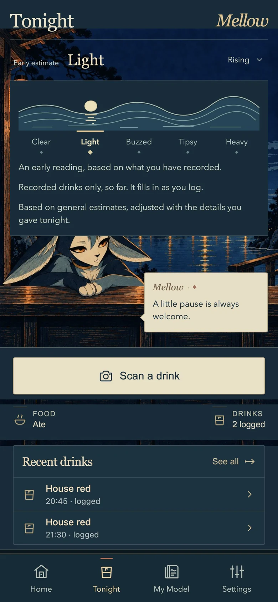
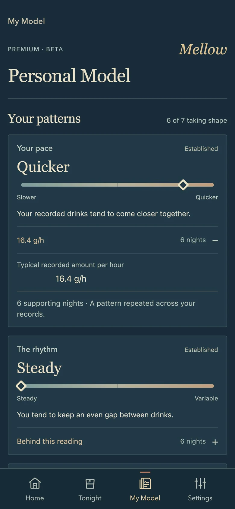
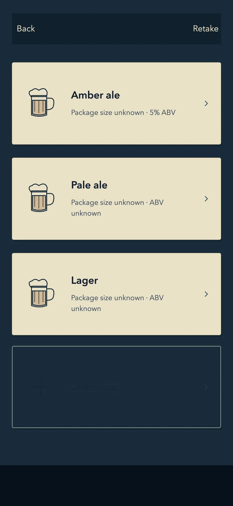
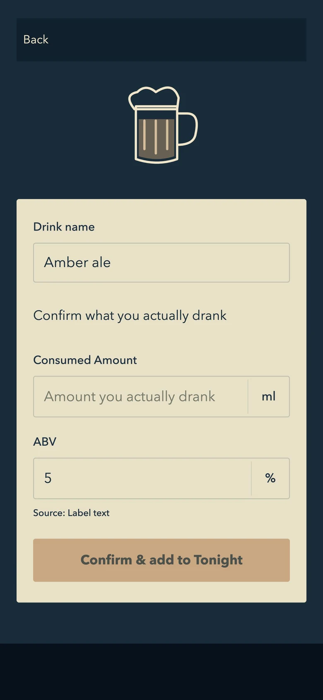

# Mellow

**A personal companion for nights you drink.**

Mellow helps people record what they actually drank, understand the estimated state of the current night, and explore patterns over time. This repository presents the product and a runnable selection of its original TypeScript logic for portfolio review.

[Product website](https://mellowtonight.app/) · [中文说明](README.zh-CN.md) · [Architecture](docs/architecture.md) · [Verification](docs/verification.md)

 

*Website Beta images, retrieved October 23, 2026. Records are illustrative; Personal Model is an internal Premium preview, not a measured real-user outcome.*

## The product problem

A photo can suggest a drink without knowing how much a person consumed. A single record can change the current estimate without establishing a long-term pattern. A fluent sentence can sound confident without having enough evidence.

Mellow keeps these distinctions visible in both the interaction design and the underlying contracts.

## Three design decisions

### 1. Confirm facts before updating state

Recognition suggestions retain unknown values. The confirmation step asks for actual consumed volume and ABV. Package size is not silently treated as consumed volume.

 

Read [`confirmation.ts`](src/intake/confirmation.ts), [`normalized.ts`](src/intake/normalized.ts) and [`units.ts`](src/agent/units.ts).

### 2. Separate the event, the decision and the wording

The content pipeline decides whether to speak, why, at what priority and with what evidence. The integration record retains the triggering event and source versions. The constrained voice composer can fall back to deterministic wording or remain silent.

Read [`shouldSpeak.ts`](src/content/shouldSpeak.ts), [`engine.ts`](src/contentIntegration/engine.ts) and [`voiceComposer.ts`](src/companion/voiceComposer.ts).

### 3. Make personalization inspectable

A reading should show what it means and the records supporting it. Missing evidence stays missing. Basic style labels and deeper personal-model access are represented separately.

Read [`evidence.ts`](src/content/evidence.ts) and [`productBoundary.ts`](src/entitlement/productBoundary.ts).

## What is included

- Selected original modules: intake confirmation and validation, unit parsing, Agent UI state transitions, content decisions, voice composition, and their required domain dependencies.
- Five original test suites for intake normalization, content decisions, voice rules, safety priorities and runtime identity fallback.
- Product imagery and a short architecture walkthrough.
- A path-and-hash manifest identifying the exact local source snapshot.

**This is a source selection, not the complete application.** The full iOS shell, backend, deployed services, Agent provider integration, private configuration and user records are not distributed here. Some legacy contract vocabulary remains in the original code; it is not a list of current consumer features.

## Run the checks

Use Node.js 22.13 or later and pnpm 11.

```sh
pnpm install --frozen-lockfile
pnpm test
pnpm typecheck
```

No account, API key, paid provider or production database is needed for these checks. See [verification](docs/verification.md) for the recorded result and scope.

## Repository map

| Path | Review focus |
| --- | --- |
| `src/intake/` | Confirmed amounts, provenance and domain validation |
| `src/agent/` | Deterministic unit parsing, state transitions and supporting contracts |
| `src/content/` | Evidence-sensitive feedback decisions and existing test suites |
| `src/contentIntegration/` | Event-linked output records |
| `src/companion/` | Constrained voice composition and fallback |
| `src/entitlement/` | Capability and personal-model boundaries |
| `docs/` | Architecture, verification and source provenance |

## Status and boundaries

Mellow is an evolving product. This public snapshot demonstrates selected design and engineering decisions; it does not establish App Store release, physical-device acceptance or clinical accuracy. Product estimates are for personal awareness, never for deciding whether it is safe to drive.

No open-source license is granted by this portfolio publication. See [rights and attribution](RIGHTS.md).
