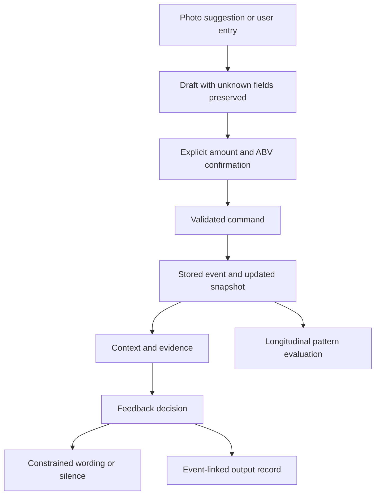

# From confirmed facts to explainable feedback

Mellow separates raw input, validated facts, derived state, a feedback decision and the words shown to the user. This page describes the existing product architecture and identifies which pieces are present in this source selection.

The command persistence layer and complete longitudinal evaluation pipeline are outside this public selection. The diagram is a product architecture map, not a claim that this repository starts the whole application.

## 1. Facts are explicit

`freshIntakeDraft` leaves unconfirmed ABV and consumed amount as `NaN`. `confirmationValues` validates the draft instead of silently accepting category defaults. `NormalizedIntake` keeps package volume and actual consumed volume distinct.

`parseUnits` performs deterministic normalization. Ambiguous pint and proof systems remain explicit rather than being guessed by provider output. This unit parser is part of the broader Agent flow; the full planner and API are not included here.

## 2. State transitions have boundaries

`agentTransition` retains the request identifier while planning and rejects a result for a different request. A commit is only accepted from `DRAFT_READY`; a save result only changes the UI from `COMMITTING`. These are UI transition guards, not a replacement for server-side authorization or persistence idempotency.

## 3. Feedback is a decision before it is a sentence

`observe` evaluates context, evidence and priorities. A decision includes `should_speak`, `reason`, `priority`, `evidence_level` and supporting facts. A valid response may be silence.

`outputRecordFor` links the decision to an event ID, event type, session, deduplication key, evidence references and output versions. The function constructs a record; storage and delivery are separate responsibilities.

`composeVoice` accepts only approved equivalent sentences, checks repetitive or invalid language, preserves priority-zero wording, and falls back when a composer fails or times out. It is the constrained companion voice mechanism, not the separate conversational Agent.

## 4. Evidence does not automatically authorize personalization

Evidence level constrains claim strength. The product capability layer separately determines which personal-model functions are available. Historical records, access rights and current model state are distinct concerns.

Content-language evidence thresholds must not be read as the complete Drinking Style publication policy. Likewise, a visible style is a record-based pattern, not a fixed psychological or medical classification.

## Code reading order

1. `src/intake/confirmation.ts`
2. `src/intake/normalized.ts`
3. `src/agent/units.ts` and `src/agent/state.ts`
4. `src/content/contracts.ts` and `src/content/shouldSpeak.ts`
5. `src/contentIntegration/engine.ts`
6. `src/companion/voiceComposer.ts`
7. `src/entitlement/productBoundary.ts`

The source manifest records original file hashes. Packaging configuration and these explanatory documents were prepared for portfolio review; original source behavior was preserved. One type-only adaptation in `runtimeId.ts` removes `null` from the `getRandomValues` generic for standalone DOM/Node compatibility; its original fallback tests are included. The manifest records both the original hash and the exported hash for that file.
